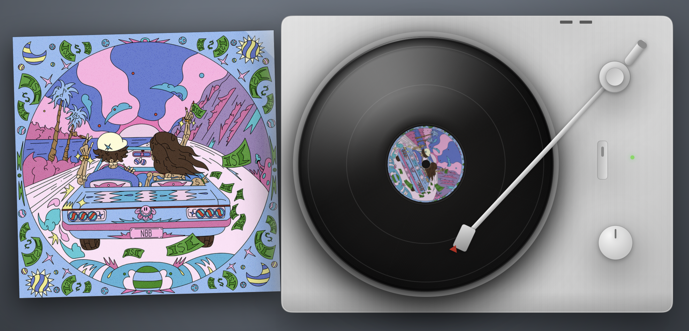

# Vinyl

A macOS app that draws a photorealistic spinning turntable as a live desktop layer — pinned above
your desktop picture, below your icons — showing the album art of whatever you're playing, on the
record and on the sleeve beside it.



Inspired by [vinylformac.com](https://vinylformac.com), written from scratch.

## What it does

- **Follows Spotify and Apple Music.** The label and the sleeve show the current track's cover art
  and change when the track does.
- **Spins while you're playing.** Pause, and the platter stops and the tonearm returns to its rest.
- **Tints the desktop with the cover.** The backdrop takes its colour from the *background* of the
  sleeve — not an average of it, which turns every busy cover to brown mud — and cross-fades
  through hue space on a track change. A mahogany desk is available instead, in Settings.
- **Stays out of the way.** The window is click-through, so clicking it clicks the desktop behind
  it. Measured CPU while playing is about 0.2%.

## Requirements

- macOS 14 (Sonoma) or later
- **Full Xcode**, not just the Command Line Tools — SwiftPM's manifest compiler doesn't work under
  CLT alone
- [XcodeGen](https://github.com/yonaskolb/XcodeGen)

## Install

There is no signed download; building it yourself is the only way to run it, for the reason below.

```bash
brew install xcodegen
```

```bash
git clone https://github.com/YOUR-USERNAME/vinyl-mac.git && cd vinyl-mac && ./scripts/build.sh
```

That builds Release, installs to `/Applications/Vinyl.app` and launches it. macOS will then ask
for permission to control Spotify and Music — that's how now-playing information is read, and
Vinyl can't show anything without it.

### Why there's no download

Handing someone a built `.app` means paying for the Apple Developer Program and notarizing the
bundle; without that, Gatekeeper blocks it on any machine but the one that built it. This is a
small free thing and that isn't worth it, so it ships as source. The build is one command.

## Settings

Vinyl has no Dock icon. It installs a menu bar item — but **if your menu bar is already full,
macOS parks that item off-screen**, which is a macOS limitation rather than something the app can
fix. Either way, you can always open the control panel by **double-clicking Vinyl in your
Applications folder**.

It offers the backdrop style and whether to launch at login.

## How it works

It isn't a wallpaper — a desktop picture can't animate. It's a borderless, click-through `NSWindow`
held at desktop-icon window level, which is what puts it above the desktop picture and below your
icons.

Everything in the scene is drawn in code; there are no image assets but the app icon. The record is
a single bitmap — grooves, label and artwork — turned by one infinite Core Animation
`transform.rotation.z`, so the spin costs almost nothing. The specular sheen deliberately sits
*outside* that rotation: on a real record those bright lobes are light diffracting off the groove
walls, and the pattern is fixed to the light source, not to the disc.

## Development

```bash
./scripts/render.sh
```

Renders `DesktopSceneView` off-screen for every cover in `Fixtures/` and writes one PNG per cover to
`renders/`. It's how to judge a visual change without a music player or the live desktop — though it
only proves the static frame, so animation still has to be watched running.

After adding or removing source files, run `xcodegen generate`. Editing existing files needs
nothing.

## Status

Working, and in daily use. Known rough edges:

- Only Spotify and Apple Music are supported. Browser playback and other players show nothing.
- Memory sits around 25 MB above baseline — traded deliberately for near-zero idle CPU.
- The menu bar item may have nowhere to go, as above.

## Licence

MIT — see [LICENSE](LICENSE).
